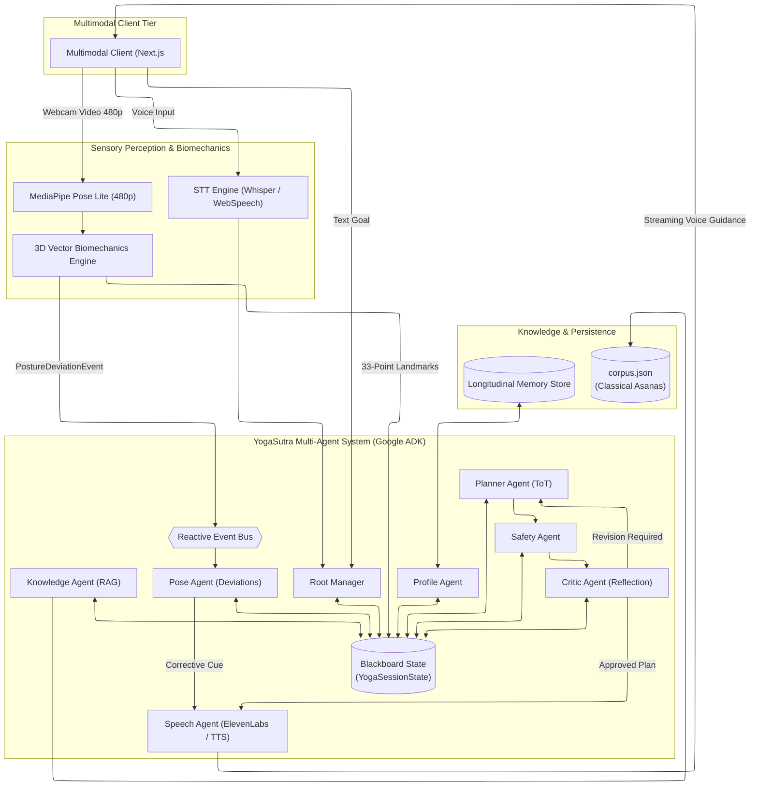

# YogaSutra 🧘

**Transparent, Safety-Critical Multi-Agent AI System for Personalised Yoga Practice, Biomechanics & Voice Guidance**

[](pyproject.toml)
[](tests/)
[](https://google.github.io/adk-docs/)
[](LICENSE)

> **Current Status**: Phase 1 (Complete ✅) | Phase 2 (Complete ✅) | Phase 3A (Complete ✅) | Phase 3B (Complete ✅) | Phase 3C (In Progress 🔄)

---

## Overview

**YogaSutra** is an enterprise-grade, multi-agent AI system designed to formulate, guide, and adapt personalized yoga practices in real time. Built upon the **Google Agent Development Kit (ADK)** and an asynchronous **Reactive Event Bus**, the system guarantees:

- **Auditable Evidence Grounding**: Every pose, sequence, and breathing technique is grounded in authenticated classical literature (`data/corpus.json`) with verifiable line-level citations.
- **Strict Deterministic Safety Guardrails**: Hard medical contraindication enforcement and biomechanical strain checks validate all plans before user presentation.
- **Closed-Loop Reflection**: An automated Critic agent evaluates plans across four standardized clinical dimensions and triggers targeted self-revisions.
- **Hands-Free Bidirectional Speech**: Low-latency voice interaction via ElevenLabs streaming TTS and Web Speech / Whisper STT for real-time mat guidance.
- **Edge-Optimized Computer Vision**: A lightweight, zero-hallucination 3D pose engine operating at 30 FPS (<100MB RAM, <12ms inference) via pure-Python vector geometry.
- **Multi-Model Provider Governance**: Intelligent dynamic routing and cascading across Google Gemini, Ollama Cloud (120B), and NVIDIA NIM with zero API budget leakage ($0 mandate).

---

## System Architecture

YogaSutra unifies **hierarchical agent coordination**, a **shared Blackboard state**, and a **decoupled reactive event bus** to handle both deliberative planning and high-frequency sensor streams:



### Specialized Agents

| Agent | Module | Role & ADK Pattern | Status |
| :--- | :--- | :--- | :---: |
| **`RootManager`** | `app/agents/root/` | Dynamic request classifier, pipeline orchestrator & session coordinator | ✅ Complete |
| **`ProfileAgent`** | `app/agents/profile/` | Extracts practitioner experience, physical limitations, duration & energy state | ✅ Complete |
| **`KnowledgeAgent`** | `app/agents/knowledge/` | ReAct retrieval agent querying classical corpus via MCP Server & pgvector | ✅ Complete |
| **`PracticePlanner`** | `app/agents/planner/` | Synthesizes physiological asana flows using Tree-of-Thought (ToT) exploration | ✅ Complete |
| **`SafetyAgent`** | `app/agents/safety/` | Deterministic validator filtering contraindications against medical rule tables | ✅ Complete |
| **`CriticAgent`** | `app/agents/critic/` | Bi-directional reflection agent auditing grounding, safety, and sequence flow | ✅ Complete |
| **`SpeechAgent`** | `app/agents/speech/` | Generates streaming voice guidance and hands-free conversational responses | ✅ Complete |
| **`PoseAgent`** | `app/agents/pose/` | Edge CV engine verifying joint angles against classical criteria matrices | ✅ Complete |

---

## Multi-Agent Workflow Patterns

YogaSutra implements and benchmarks four interchangeable agent coordination topologies:

1. **Sequential Workflow (`app/workflows/sequential.py`)**: Predictable linear execution (`Profile → RAG → Planner → Safety → Critic → Speech`).
2. **Hierarchical Workflow (`app/workflows/hierarchical.py`)**: Root Manager delegates sub-tasks to specialized agents and synthesizes outputs.
3. **Broadcast / Parallel Workflow (`app/workflows/broadcast.py`)**: Concurrent task dispatch to independent specialists to minimize end-to-end latency.
4. **Blackboard Workflow (`app/workflows/blackboard.py`)**: Agents communicate asynchronously by reading and writing to `YogaSessionState`.
5. **Event-Driven Bus (`app/workflows/event_driven.py`)**: Decoupled, non-blocking bus dispatching `PostureDeviationEvent`, `VoiceCommandEvent`, and `SessionCompletedEvent`.

---

## Project Structure

```
YogaSutra_Repo/
├── app/
│   ├── agents/                  # Specialized ADK agents
│   │   ├── root/                # Root Manager orchestrator
│   │   ├── profile/             # Profile & preference extraction
│   │   ├── knowledge/           # Classical RAG retrieval agent
│   │   ├── planner/             # Practice planner & Tree-of-Thought
│   │   ├── safety/              # Deterministic safety & contraindication auditor
│   │   ├── critic/              # Critic agent & reflection revision loop
│   │   └── speech/              # Speech & audio agent (TTS / STT)
│   ├── audio/                   # Audio pipeline & voice synthesis
│   │   ├── elevenlabs.py        # ElevenLabs streaming client
│   │   ├── tts.py               # Unified TTS engine (Google Cloud / WebSpeech)
│   │   ├── stt.py               # Speech-to-Text transcription
│   │   └── cache.py             # Audio file & hash cache
│   ├── models/                  # Multi-provider model gateway
│   │   ├── gateway.py           # Model Gateway abstraction
│   │   ├── router.py            # Dynamic cost/latency scoring router
│   │   ├── rate_limiter.py      # Token & request rate limiting
│   │   └── cache.py             # LLM response caching
│   ├── memory/                  # State persistence & user journals
│   │   ├── longitudinal.py      # Longitudinal practice store
│   │   ├── user_store.py        # User profile repository
│   │   └── session_store.py     # Session execution history
│   ├── mcp/                     # Model Context Protocol
│   │   ├── server.py            # YogaSutra MCP knowledge server
│   │   └── client.py            # MCP client for KnowledgeAgent
│   ├── tools/                   # Deterministic agent tools
│   │   ├── retrieval.py         # Knowledge chunk retrieval
│   │   ├── safety.py            # Anatomical rule checks
│   │   ├── planning.py          # Sequence builders & duration math
│   │   ├── audio_tools.py       # Spoken cue generators
│   │   └── profile.py           # User state utilities
│   ├── workflows/               # MAS execution topologies
│   │   ├── sequential.py        # Linear execution pipeline
│   │   ├── hierarchical.py      # Supervisor-worker hierarchy
│   │   ├── broadcast.py         # Parallel specialist fan-out
│   │   ├── blackboard.py        # Shared-state collaborative workflow
│   │   └── event_driven.py      # Async EventBus & event schemas
│   ├── api/                     # REST API microservice
│   │   ├── server.py            # FastAPI server with healthchecks
│   │   └── static/              # Web client assets
│   ├── ui/                      # Observability & visualizers
│   │   ├── dashboard.py         # Streamlit telemetry dashboard
│   │   └── live_graph.py        # Terminal live execution graph
│   ├── tracing/                 # OpenTelemetry & JSON execution tracing
│   │   └── trace.py             # TraceCollector & Step metrics
│   ├── state.py                 # Pydantic Blackboard session models
│   └── runner.py                # Runner setup & execution lifecycle
├── data/
│   ├── corpus.json              # Curated classical yoga knowledge chunks
│   ├── memory/                  # Persistent practice records & session journals
│   └── traces/                  # Auto-generated JSON execution traces
├── scripts/
│   ├── ingest_corpus.py         # Corpus embedding & ingestion script
│   └── run_latency_benchmark.py # Multi-model latency & throughput benchmark
├── tests/                       # 15 automated test suites (123 unit tests)
├── main.py                      # CLI entry point with Rich visualizer
├── pyproject.toml               # Build dependencies & packaging
└── PLAN.md                      # Comprehensive project blueprint & design specification
```

---

## Quick Start

### 1. Prerequisites
- Python 3.11, 3.12, or 3.14
- Free-tier API keys:
  - `GOOGLE_API_KEY` (Gemini Flash — [Google AI Studio](https://aistudio.google.com/apikey))
  - `ELEVENLABS_API_KEY` *(optional, for high-fidelity voice cues)*

### 2. Installation
```bash
# Clone the repository
git clone https://github.com/ojhaprathmesh/YogaSutra_Repo.git
cd YogaSutra_Repo

# Set up virtual environment using uv or venv
uv venv .venv
source .venv/bin/activate

# Install dependencies in editable mode with dev tools
uv sync --extra dev
# Alternatively with pip: pip install -e ".[dev]"
```

### 3. Environment Configuration
```bash
cp .env.example .env
# Edit .env and supply your GOOGLE_API_KEY
```

### 4. Run the Interactive CLI
```bash
# Execute Phase 2 Full Multi-Agent Pipeline (Default)
python3 main.py

# Execute with custom goal and persona
python3 main.py --input "I have lower back stiffness and 15 minutes. Gentle morning practice." --persona P02

# Run with legacy Phase 1 pipeline
python3 main.py --phase 1
```

### 5. Launch the FastAPI Server & Observability
```bash
# Start FastAPI backend server
uvicorn app.api.server:app --reload --port 8000

# Access interactive API docs at http://localhost:8000/docs
# Health status check: http://localhost:8000/health
```

### 6. Run Test Suites
```bash
# Run all 153 automated unit tests
pytest tests/ -v
```

---

## Roadmap & Project Phases

| Phase | Description | Focus Areas | Status |
| :---: | :--- | :--- | :---: |
| **Phase 1** | Minimal Google ADK Proof of Concept | Root, Profile, Knowledge, Planner agents, basic tracing | ✅ Complete |
| **Phase 2** | Full Working Multi-Agent Prototype | Safety, Critic, Speech agents, 4 workflows, longitudinal memory | ✅ Complete |
| **Phase 3A** | Advanced Agent Intelligence & Event Bus | Asynchronous Reactive `EventBus`, ToT planning, MCP server | ✅ Complete |
| **Phase 3B** | Edge Real-Time Computer Vision Engine | OpenCV 480p clamp, MediaPipe Lite 3D landmarks, deterministic vector math | ✅ Complete |
| **Phase 3C** | Fullstack Live Practice Studio UI | HTML5 Canvas wireframe, audio player, trace visualizer | 📋 Scheduled |
| **Phase 4** | Scientific Evaluation & Benchmarking | 40+ Persona runs, HITL expert panel grading, 4-way MAS comparison | 📋 Scheduled |
| **Phase 5** | Enterprise Containerization & Docker | Multi-stage Dockerfiles, Docker Compose, Nginx, healthchecks | 📋 Scheduled |
| **Phase 6** | Client Handover & Final Technical Report | Turnkey deployment bundle, IEEE report (`docs/FINAL_REPORT.md`), viva defense | 📋 Scheduled |

---

## Environment Variables

| Variable | Default | Description |
| :--- | :--- | :--- |
| `GOOGLE_API_KEY` | *(required)* | Google Gemini API key for ADK agents |
| `ELEVENLABS_API_KEY` | *(optional)* | ElevenLabs API key for high-fidelity audio cues |
| `YOGASUTRA_MODEL` | `gemini-2.5-flash` | Default LLM model for agents |
| `YOGASUTRA_TRACE_DIR` | `data/traces` | Directory storing JSON execution traces |
| `YOGASUTRA_MEMORY_DIR`| `data/memory` | Directory storing persistent user practice records |
| `YOGASUTRA_LOG_LEVEL` | `INFO` | System logging verbosity (`DEBUG`, `INFO`, `WARNING`) |

---

## License

This project is licensed under the MIT License. See [LICENSE](LICENSE) for details.
